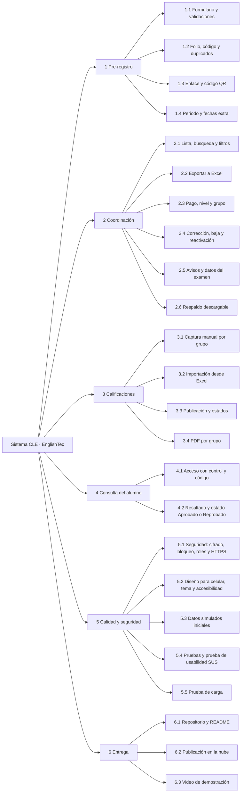

# Misión 2 · Alcance

- **EnglishTec** · Consultora de Software Para Instituciones Educativas
- **Cliente:** TecNM Campus Matehuala · Coordinación de Lenguas Extranjeras (CLE)
- **Proyecto:** Sistema de Pre-Registro y Consulta de Calificaciones de Los Cursos de Inglés
- **Consultora:** Myrka Neftalí Salazar Morales · Noviembre de 2026

> Todos los datos del sistema son **Simulados**. No se usa ningún dato real de alumnos ni de personal.

---

## 1. Qué Automatiza El Proyecto

El proyecto automatiza **La Parte Humana** del proceso de la CLE que hoy se hace a mano:

1. **Pre-Registro** de inscripción y reinscripción al curso de inglés (hoy: hoja impresa, alumnos que van a la Coordinación y recorridos por los salones).
2. **Captura y Publicación de Calificaciones** por parte de los docentes (hoy: hoja de OneDrive a la que los alumnos no tienen acceso).
3. **Consulta del Resultado** por el alumno desde el celular (hoy: buscar al docente o ir a la Coordinación, unas 2 veces según las 3 entrevistas).

**Sigue Siendo Humano, A Propósito:** el pago del examen ($500, trámite con banco o Tec, Financieros y factura), la aplicación del examen de ubicación y la asignación del nivel con el resultado del examen. El sistema solo registra el resultado de esos pasos.

---

## 2. Requisitos Funcionales (14)

Prioridad MoSCoW: **Debe** · **Debería** · **Podría** · **No Esta Vez**.
Los criterios «se cumple si…» se prueban con los datos simulados que el sistema trae desde el primer arranque (100 alumnos, 10 grupos: 3 publicados, 3 capturados sin publicar y 4 sin calificaciones; 15 pagos pendientes).

| ID | Requisito | Prioridad | Se Cumple Si… | Paquete de la EDT |
|---|---|---|---|---|
| RF-01 | El sistema debe abrir el formulario de pre-registro al escanear un código QR o entrar a un enlace, y permitir a la Coordinación descargar el QR y copiar el enlace. | Debe | Al escanear el QR con un celular se abre el formulario sin pedir cuenta ni instalar nada; la Coordinación descarga el QR en imagen y copia el enlace. | 1.3 |
| RF-02 | El sistema debe capturar los datos de la hoja manual (nombre, número de control, carrera, semestre, teléfono, correo y tipo de inscripción) y validarlos campo por campo. El nivel no se pregunta. | Debe | Un teléfono de 9 dígitos es rechazado con un mensaje que nombra el campo y la corrección; con todos los datos válidos el registro se guarda. | 1.1 |
| RF-03 | El sistema debe guardar cada pre-registro con folio, fecha y hora, mostrar al alumno su folio y su código de consulta propio, y evitar duplicados del mismo número de control. | Debe | Un registro válido muestra un folio con formato CLE-2026-#### y un código de 8 caracteres que se puede copiar; al enviar de nuevo el mismo número de control no se crea otro y se muestra el folio ya existente. | 1.2 |
| RF-04 | El sistema debe permitir a la Coordinación consultar, buscar, filtrar y exportar a Excel la lista de pre-registros. | Debe | La lista inicial muestra 100 registros; se filtra por nombre, número de control o folio, por pago pendiente (15) o recibido (85) y por dados de baja; el Excel trae las 13 columnas de la lista. | 2.1, 2.2 |
| RF-05 | El sistema debe permitir a la Coordinación marcar un pago como recibido, con fecha, y mostrar ese estado al alumno. | Debería | Al marcar un pago pendiente, los pendientes bajan de 15 a 14 y el alumno ve «Pago Recibido» con su fecha; un docente no puede marcarlo. | 2.3 |
| RF-06 | El sistema debe permitir a la Coordinación abrir y cerrar el periodo de pre-registro y habilitar fechas extra por número de control. | Debería | Con el periodo cerrado, un número nuevo recibe el aviso de periodo cerrado; con una fecha extra para ese número, el registro se acepta una sola vez. | 1.4 |
| RF-07 | El sistema debe permitir a la Coordinación publicar avisos y capturar la fecha y el lugar del examen de ubicación para que el alumno los vea. | Debería | Un aviso nuevo aparece en la página del alumno con su fecha; al cambiar la fecha o el lugar del examen, el alumno los ve en su consulta. | 2.5 |
| RF-08 | El sistema debe permitir a la Coordinación asignar el nivel (1 a 5) y el grupo de cada alumno. | Debe | Un alumno sin nivel ve «Nivel Por Asignar»; al asignar un nivel del 1 al 5 lo ve en su consulta y un nivel fuera de ese rango es rechazado; al asignarle grupo, aparece en la lista del docente de ese grupo. | 2.3 |
| RF-09 | El sistema debe permitir a la Coordinación corregir los datos de un registro, darlo de baja con motivo, reactivarlo, eliminarlo definitivamente y restablecer el código de consulta. | Debería | La baja exige un motivo, elimina las calificaciones del alumno y le impide consultar; reactivar lo regresa a la lista activa sin grupo; solo se elimina un registro que ya está de baja; tras restablecer el código, el anterior deja de funcionar. | 2.4 |
| RF-10 | El sistema debe permitir al docente capturar o importar desde Excel las calificaciones de su grupo, con validación, y borrar una captura que aún no está publicada. | Debe | Al importar `prueba_importar_Ingles1B.xlsx` en Inglés 1 · Grupo B se guardan las 10 filas; una fila con un número de control ajeno al grupo se reporta con su número de fila y su motivo; una calificación fuera de 0 a 100 se rechaza; un docente no ve ni modifica grupos de otro; dejar las 4 casillas vacías borra la captura solo si el grupo no está publicado. | 3.1, 3.2 |
| RF-11 | El sistema debe permitir al docente publicar las calificaciones de su grupo y mostrar a la Coordinación el estado de cada grupo (pendiente, capturado o publicado). | Debe | Antes de publicar, el alumno de Inglés 4 · Grupo A ve que sus calificaciones aún no están publicadas; después de publicar, ve sus 4 unidades; la Coordinación ve a cada grupo con su docente y su estado (al inicio: 3 publicados, 3 capturados y 4 pendientes). | 3.3 |
| RF-12 | El sistema debe permitir al alumno consultar desde el celular, con su número de control y su código propio, sus 4 unidades, su calificación general y el resultado Aprobado o Reprobado. | Debe | El alumno 20000001 ve sus 4 unidades, general 84 y «Resultado: Aprobado»; el 20000004 ve general 52 y «Resultado: Reprobado»; el 20000009 tiene 2 unidades menores a 70 pero general 77.25 (se muestra 77.2) y «Resultado: Aprobado»; con un código incorrecto no entra y solo ve su propia información. | 4.1, 4.2 |
| RF-13 | El sistema debe generar en PDF las calificaciones de un grupo, con su estado, para imprimir y archivar. | Debería | El PDF de Inglés 1 · Grupo A trae docente, estado «Publicado» y los 10 alumnos con sus calificaciones; un grupo capturado sin publicar muestra «Borrador»; un grupo sin calificaciones muestra «Pendiente». | 3.4 |
| RF-14 | El sistema debe permitir a la Coordinación descargar un respaldo completo de los registros, con la fecha del día. | Debería | El archivo descargado trae la fecha de generación y contiene los alumnos, grupos, calificaciones, ajustes, fechas extra y avisos. | 2.6 |

---

## 3. Requisitos No Funcionales (4)

| ID | Requisito | Prioridad | Se cumple si… | Paquete de la EDT |
|---|---|---|---|---|
| RNF-01 | **Usabilidad y Accesibilidad.** El sistema debe poder usarse con facilidad desde un celular, con textos legibles y mensajes de error claros. | Debe | Un usuario de prueba completa el pre-registro en 5 minutos o menos; a 360 px de ancho no hay desplazamiento horizontal; el contraste de los textos es de al menos 4.5:1 en tema claro y oscuro; cada error indica el campo y qué corregir; el tema elegido se conserva al volver a entrar; el SUS promedio de 5 usuarios es de 70 o más. | 5.2, 5.4 |
| RNF-02 | **Seguridad y Privacidad.** El sistema debe proteger el acceso a la información de cada alumno y al panel del personal. | Debe | El código de consulta se guarda cifrado (no se puede leer en la base de datos); el 5.º intento fallido bloquea el acceso 10 minutos; cada alumno ve solo su información; el sistema no pide el NIP institucional; el acceso por HTTP redirige a HTTPS; las rutas de Coordinación y Docente responden «sin sesión» si no se inició sesión y un docente no entra a grupos ajenos. | 5.1 |
| RNF-03 | **Rendimiento.** El sistema debe responder sin errores durante el periodo de pre-registro, con una meta de diseño de 100 usuarios a la vez. | Debería | En una prueba de carga con 100 usuarios simultáneos sobre el sistema publicado, todas las respuestas son correctas y el tiempo de respuesta en el percentil 95 es menor a 3 segundos (se mide en la Misión 8). | 5.5 |
| RNF-04 | **Disponibilidad y Conservación de Datos.** El sistema debe conservar los registros mientras esté en operación y permitir respaldarlos en cualquier momento. | Debería | Tras cerrar sesión y volver a entrar, los registros siguen ahí; el respaldo se puede descargar (RF-14). *Limitación de La Demostración:* en el hospedaje gratuito de Render el disco se reinicia y los datos vuelven a la semilla; una operación real requiere almacenamiento persistente. | 2.6, 6.2 |

---

## 4. Reglas de Negocio

Son políticas de la CLE que el sistema debe respetar. Las RN-12 a RN-14 se confirmaron con la Coordinación durante el desarrollo del prototipo.

| ID | Regla | Estado |
|---|---|---|
| RN-01 | El examen de ubicación cuesta $500 y se paga en las fechas publicadas. | Vigente |
| RN-02 | El pago se hace con el proceso actual: banco o Tec, comprobante, Financieros, factura y entrega en la Coordinación. Queda fuera del sistema. | Vigente |
| RN-03 | La Coordinación coteja la factura y marca el pago como recibido. | Vigente |
| RN-04 | Las fechas extra de pre-registro las asigna la Coordinación. | Vigente |
| RN-05 | El examen es digital, en laboratorio de cómputo, en la fecha que dicta la Coordinación. | Vigente |
| RN-06 | El nivel del alumno lo asigna la Coordinación con el resultado del examen. | Vigente |
| RN-07 | El docente captura las calificaciones de su grupo. | Vigente |
| RN-08 | La Coordinación conserva el archivo físico y emite las constancias. | Vigente |
| RN-09 | El código de consulta es propio del curso de inglés: el sistema no pide ni guarda el NIP institucional. | Propuesta de diseño |
| RN-10 | La hoja de calificaciones de OneDrive es solo de docentes y Coordinación; en el sistema, cada alumno ve únicamente las suyas. | Hoja: vigente. Vista del alumno: propuesta |
| RN-11 | Teams sigue siendo el canal de avisos; el sistema aporta el enlace y el QR. | Vigente |
| RN-12 | El mínimo aprobatorio es 70; una calificación general menor a 70 es reprobatoria. | Vigente |
| RN-13 | La calificación general es la suma de las 4 unidades dividida entre 4, el número de unidades que se cursan en cada nivel. | Vigente |
| RN-14 | La baja elimina al alumno del curso y sus calificaciones. Para volver debe realizar el proceso de pago y recibe el grupo del nivel que dejó. Una baja definitiva ya no tiene ningún proceso. | Decisión de la Coordinación para el prototipo |

---

## 5. Restricciones del Proyecto (Requisitos «Debe»)

1. Todos los datos son simulados; nunca se usan datos reales de alumnos ni de personal (RF-02, RNF-02).
2. El sistema no procesa pagos ni sustituye el trámite con Financieros (RN-02).
3. El sistema no usa el NIP institucional (RN-09, RNF-02).
4. El nivel lo asigna la Coordinación; el formulario no lo pregunta (RN-06, RF-02, RF-08).
5. Cada alumno ve solo su información (RN-10, RNF-02).

---

## 6. Qué Queda Fuera («No Esta Vez»)

- Pagos en línea y automatizar el trámite con Financieros.
- Aplicar el examen digital dentro del sistema.
- Integración con el sistema escolar institucional y uso del NIP institucional.
- Restaurar registros desde el respaldo de forma automática (el respaldo se descarga; restaurar es manual).

---

## 7. Resumen de Prioridades

- **Debe (10):** RF-01, RF-02, RF-03, RF-04, RF-08, RF-10, RF-11, RF-12, RNF-01 y RNF-02, más las reglas de negocio vigentes y las restricciones del proyecto.
- **Debería (8):** RF-05, RF-06, RF-07, RF-09, RF-13, RF-14, RNF-03 y RNF-04.
- **Podría:** ninguno. El cambio de tema claro y oscuro, que en E2 era «Podría», se integró al RNF-01.
- **No esta vez:** lo listado en la sección 6.

---

## 8. Estructura de Desglose del Trabajo (EDT)

Los paquetes se definieron para que cada uno sea de **máximo 8 horas**. Las estimaciones con tres puntos (optimista, más probable y pesimista) se calculan en `3-cronograma.md`.

---

## 9. Trazabilidad Con La Especificación Anterior (E2)

Los requisitos se agruparon para cumplir el rango de la práctica (10 a 14 funcionales y 4 no funcionales). No se eliminó ninguna función.

- RF-01 ← E2: RF-01, RF-09
- RF-02 ← E2: RF-02
- RF-03 ← E2: RF-03, RF-04, RF-05
- RF-04 ← E2: RF-06
- RF-05 ← E2: RF-07
- RF-06 ← E2: RF-08
- RF-07 ← E2: RF-10
- RF-08 ← E2: RF-11 y la asignación de grupo (nueva)
- RF-09 ← E2: RF-17 y la corrección, baja, reactivación y eliminación (nuevas)
- RF-10 ← E2: RF-12 y el borrado de captura (nuevo)
- RF-11 ← E2: RF-13, RF-14
- RF-12 ← E2: RF-15 y el resultado Aprobado o Reprobado (nuevo)
- RF-13 ← E2: RF-16
- RF-14 ← E2: RNF-09, redactado como respaldo descargable
- RNF-01 ← E2: RNF-02, RNF-03, RNF-04, RNF-05, RNF-10
- RNF-02 ← E2: RNF-06, RNF-07, RNF-08
- RNF-03 ← E2: RNF-01
- RNF-04 ← E2: RNF-09
